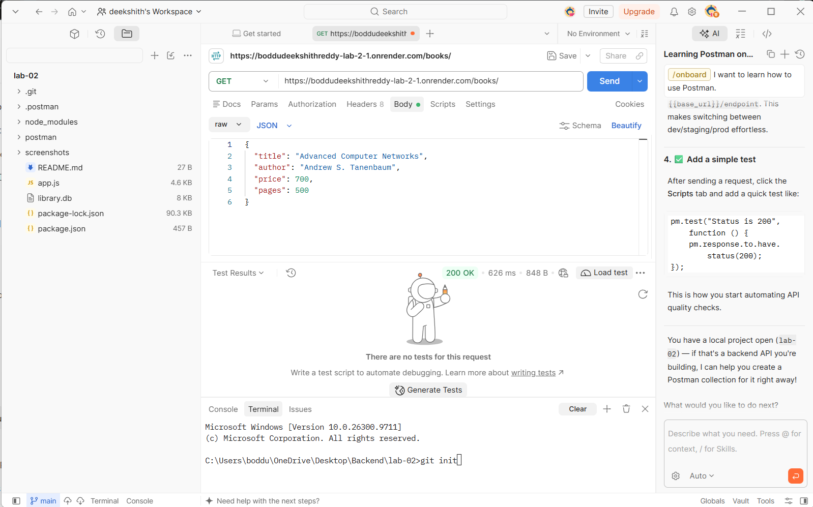
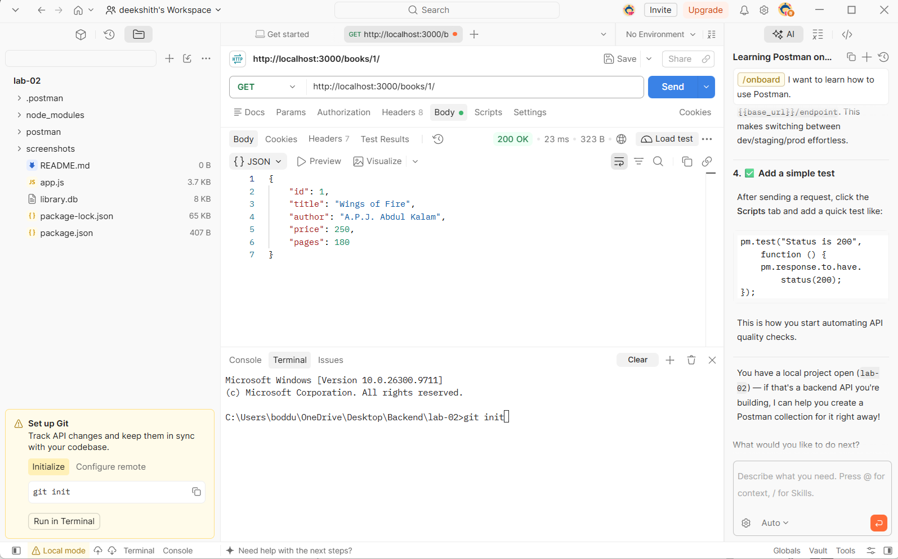
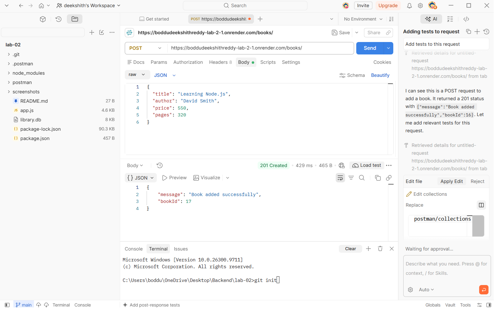
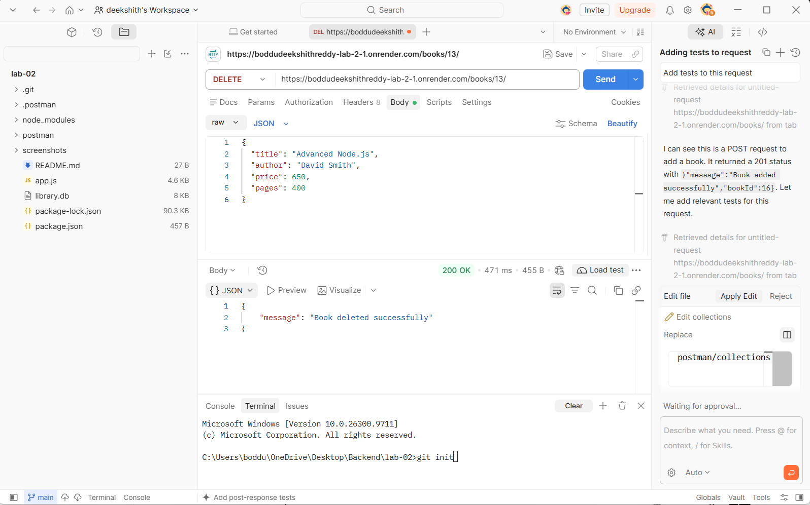
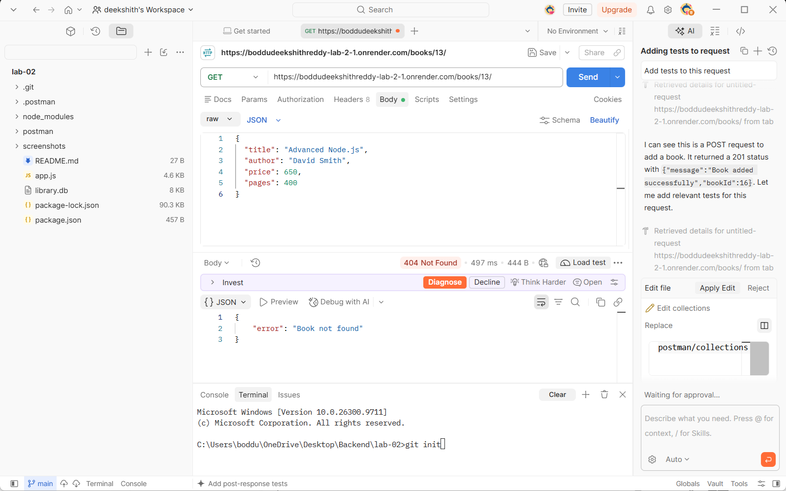

# BDF Lab 02 – SQLite Database and CRUD Routes

## Student Details

- **Name:** Boddu Deekshith Reddy
- **Registration Number:** [Enter Your Registration Number]
- **Section:** [Enter Your Section]
- **Lab Number:** 02
- **Lab Title:** SQLite Database and CRUD Routes

---

## 1. Project Description

This project demonstrates how to integrate an SQLite database with a Node.js and Express.js application.

It implements CRUD (Create, Read, Update, Delete) operations for managing book records through REST API endpoints.

The application uses SQLite to store book information and Express.js to handle HTTP requests and responses.

## 2. Technologies Used

- Node.js
- Express.js
- SQLite
- SQLite3
- JavaScript
- Postman
- Git and GitHub
- Render (Deployment)

## 3. Project Structure

```text
lab-02/
│
├── app.js
├── library.db
├── package.json
├── package-lock.json
├── .gitignore
├── README.md
│
├── screenshots/
│   ├── 01-get-all-books.png
│   ├── 02-get-book-by-id.png
│   ├── 03-post-add-book.png
│   ├── 04-put-update-book.png
│   ├── 05-delete-book.png
│   └── 06-verify-deleted-book.png
│
└── postman/
    └── collections/
        └── BDF_Lab_02.postman_collection.json
```

## 4. Installation and Setup

### Prerequisites

- Node.js installed
- npm installed
- VS Code
- Postman

### Step 1: Clone the Repository

```bash
git clone https://github.com/boddudeekshithreddy/boddudeekshithreddy_lab-2.git
```

### Step 2: Navigate to the Project Folder

```bash
cd boddudeekshithreddy_lab-2
```

### Step 3: Install Dependencies

```bash
npm install
```

### Step 4: Start the Development Server

```bash
npm run dev
```

Alternatively, run the application using:

```bash
npm start
```

The server runs on port 3000 locally, or the port provided by the deployment platform.

Expected terminal output:

```text
Database connected successfully
Server running on port 3000
```

## 5. Database Structure

**Database Name:** `library.db`

**Table Name:** `book`

| Column | Data Type | Description |
|---|---|---|
| id | INTEGER | Primary key |
| title | TEXT | Book title |
| author | TEXT | Author name |
| price | INTEGER | Book price |
| pages | INTEGER | Number of pages |

The database contains initial book records for testing the CRUD operations.

## 6. API Endpoints

**Base URL:**

```text
https://boddudeekshithreddy-lab-2-1.onrender.com
```

| HTTP Method | Endpoint | Description |
|---|---|---|
| GET | `/books/` | Retrieve all books |
| GET | `/books/:bookId/` | Retrieve a book by ID |
| POST | `/books/` | Add a new book |
| PUT | `/books/:bookId/` | Update a book |
| DELETE | `/books/:bookId/` | Delete a book |

## 7. API Testing Using Postman

All API endpoints are tested using Postman with the deployed Render URL.

### 7.1 GET – Retrieve All Books

**Endpoint:**

```http
GET /books/
```

**Description:** Retrieves all book records from the SQLite database.

**Expected Status:** `200 OK`

**Screenshot:**



### 7.2 GET – Retrieve Book by ID

**Endpoint:**

```http
GET /books/1/
```

**Description:** Retrieves a particular book using its ID.

**Expected Status:** `200 OK`

**Screenshot:**



### 7.3 POST – Add a New Book

**Endpoint:**

```http
POST /books/
```

**Request Body:**

```json
{
  "title": "Learning Node.js",
  "author": "David Smith",
  "price": 550,
  "pages": 320
}
```

**Description:** Inserts a new book record into the SQLite database.

**Expected Status:** `201 Created`

**Screenshot:**



### 7.4 PUT – Update a Book

**Endpoint:**

```http
PUT /books/13/
```

**Request Body:**

```json
{
  "title": "Advanced Node.js",
  "author": "David Smith",
  "price": 650,
  "pages": 400
}
```

**Description:** Updates an existing book record using its ID.

**Expected Status:** `200 OK`

**Screenshot:**


### 7.5 DELETE – Delete a Book

**Endpoint:**

```http
DELETE /books/13/
```

**Description:** Deletes an existing book record from the database.

**Expected Status:** `200 OK`

**Screenshot:**



### 7.6 Verify Deleted Book

**Endpoint:**

```http
GET /books/13/
```

**Description:** Checks whether the deleted book still exists in the database.

**Expected Status:** `404 Not Found`

**Screenshot:**



> Note: Replace book ID `13` in the PUT and DELETE examples with the actual ID returned by your POST request, if different.

## 8. Postman Collection

The Postman collection contains requests for testing all CRUD operations.

**Collection Name:** `BDF Lab 02 - SQLite CRUD API`

**Collection File:**

```text
postman/collections/BDF_Lab_02.postman_collection.json
```

## 9. Live Deployment

The application is deployed using Render.

**Live Application URL:**

https://boddudeekshithreddy-lab-2-1.onrender.com

**Test API:**

https://boddudeekshithreddy-lab-2-1.onrender.com/books/

## 10. Learning Outcomes

- Learned how to connect SQLite with Node.js.
- Learned how to create and manage database tables.
- Implemented REST API endpoints using Express.js.
- Practiced GET, POST, PUT and DELETE operations.
- Learned how to use parameterized SQL queries.
- Tested API endpoints using Postman.
- Learned how to deploy a Node.js application using Render.
- Learned how to maintain project files using Git and GitHub.

## 11. Conclusion

This lab helped me understand the integration of SQLite databases with Node.js and Express.js. I implemented all five CRUD API endpoints and tested them using Postman. I also learned how to deploy a backend application using Render and maintain the project in GitHub.

---

**Repository:** https://github.com/boddudeekshithreddy/boddudeekshithreddy_lab-2

**Deployment:** https://boddudeekshithreddy-lab-2-1.onrender.com